Interpretacion del Modelo de Dengue
================
2026-11-09

### Cargar CSV

``` r
dengue_etapa1 <- readr::read_csv("../Data/Csv/Etapas_dengue.csv") %>%
  dplyr::mutate(
    brote = factor(as.integer(brote)),
    tiempo_factor = factor(calendar_start_date),
    year = factor(year),
    mes = factor(mes,
                 levels = c("Ene","Feb","Mar","Abr","May","Jun",
                            "Jul","Ago","Sep","Oct","Nov","Dic"))
  )
```

    ## Rows: 8280 Columns: 17
    ## ── Column specification ────────────────────────────────────────────────────────
    ## Delimiter: ","
    ## chr   (2): DEPARTAMENTO, mes
    ## dbl  (12): Year, dengue_total, Temperature, Rain, nino34_12s, Rain_acc3, cas...
    ## date  (3): calendar_start_date, calendar_end_date, tiempo_factor
    ## 
    ## ℹ Use `spec()` to retrieve the full column specification for this data.
    ## ℹ Specify the column types or set `show_col_types = FALSE` to quiet this message.

``` r
dengue_etapa2 <- dengue_etapa1 %>%
  dplyr::filter(brote == "1") %>%
  dplyr::mutate(exceso_brote = round(dengue_total - threshold))

dplyr::glimpse(dengue_etapa1)
```

    ## Rows: 8,280
    ## Columns: 17
    ## $ DEPARTAMENTO             <chr> "BILWI", "BILWI", "BILWI", "BILWI", "BILWI", …
    ## $ calendar_start_date      <date> 2014-01-19, 2014-01-26, 2014-02-02, 2014-02-…
    ## $ calendar_end_date        <date> 2014-01-25, 2014-02-01, 2014-02-08, 2014-02-…
    ## $ Year                     <dbl> 2014, 2014, 2014, 2014, 2014, 2014, 2014, 201…
    ## $ dengue_total             <dbl> 0, 1, 2, 3, 6, 6, 14, 9, 8, 3, 1, 6, 1, 3, 4,…
    ## $ Temperature              <dbl> 23.94286, 24.65714, 25.04286, 25.28571, 25.27…
    ## $ Rain                     <dbl> 18.8, 8.6, 6.0, 9.3, 11.0, 3.2, 6.8, 5.6, 2.5…
    ## $ nino34_12s               <dbl> -0.2666667, -0.3000000, -0.4000000, -0.483333…
    ## $ Rain_acc3                <dbl> 53.3, 38.5, 33.4, 23.9, 26.3, 23.5, 21.0, 15.…
    ## $ casos_semana_anterior    <dbl> 0, 0, 1, 2, 3, 6, 6, 14, 9, 8, 3, 1, 6, 1, 3,…
    ## $ ln_dengue                <dbl> 0.0000000, 0.6931472, 1.0986123, 1.3862944, 1…
    ## $ ln_casos_semana_anterior <dbl> 0.0000000, 0.0000000, 0.6931472, 1.0986123, 1…
    ## $ tiempo_factor            <fct> 2014-01-19, 2014-01-26, 2014-02-02, 2014-02-0…
    ## $ mes                      <fct> Ene, Ene, Feb, Feb, Feb, Feb, Mar, Mar, Mar, …
    ## $ year                     <fct> 2014, 2014, 2014, 2014, 2014, 2014, 2014, 201…
    ## $ threshold                <dbl> 24, 24, 24, 24, 24, 24, 24, 24, 24, 24, 24, 2…
    ## $ brote                    <fct> 0, 0, 0, 0, 0, 0, 0, 0, 0, 0, 0, 0, 0, 0, 0, …

# Resumen del modelo

La definición del evento de brote `brote` se estableció aislando las
semanas epidemiológicas donde los casos superan el percentil 75 de la
distribución histórica de cada departamento. Esta decisión metodológica
se fundamenta en la técnica del Canal Endémico respaldada por la
Organización Panamericana de la Salud (OPS). El umbral se calcula dentro
de cada departamento, por lo que Managua y Bilwi no comparten el mismo
punto de corte. En total se clasificaron 2,047 semanas como brote (24.7%
de la serie).

El factor tiempo se incorporó en tres componentes: `mes` captura la
estacionalidad intra-anual, `year` controla la tendencia de largo plazo
(2014-2022) y `tiempo_factor` alimenta la estructura autorregresiva
AR(1) dentro de cada departamento. Esto evita atribuir a las variables
ambientales variaciones que en realidad son tendencia secular o
estacionalidad.

``` r
modelo_etapa_1 <- glmmTMB(
  brote ~
    nino34_12s + 
    Rain_acc3 +             
    Temperature +  
    mes +
    year +
    ln_casos_semana_anterior +
    (1 | DEPARTAMENTO) +  #random intercept by department
    ar1(tiempo_factor + 0 | DEPARTAMENTO), 
  family = binomial(link = "logit"),
  data = dengue_etapa1
)

summary(modelo_etapa_1)
```

    ##  Family: binomial  ( logit )
    ## Formula:          
    ## brote ~ nino34_12s + Rain_acc3 + Temperature + mes + year + ln_casos_semana_anterior +  
    ##     (1 | DEPARTAMENTO) + ar1(tiempo_factor + 0 | DEPARTAMENTO)
    ## Data: dengue_etapa1
    ## 
    ##       AIC       BIC    logLik -2*log(L)  df.resid 
    ##    3602.8    3792.3   -1774.4    3548.8      8253 
    ## 
    ## Random effects:
    ## 
    ## Conditional model:
    ##  Groups         Name                    Variance Std.Dev. Corr      
    ##  DEPARTAMENTO   (Intercept)             5.4290   2.3300             
    ##  DEPARTAMENTO.1 tiempo_factor2014-01-19 0.9123   0.9552   0.96 (ar1)
    ## Number of obs: 8280, groups:  DEPARTAMENTO, 18
    ## 
    ## Conditional model:
    ##                            Estimate Std. Error z value Pr(>|z|)    
    ## (Intercept)              -2.446e+01  2.110e+00 -11.591  < 2e-16 ***
    ## nino34_12s                1.323e-01  1.165e-01   1.135 0.256284    
    ## Rain_acc3                 2.385e-03  7.194e-04   3.316 0.000914 ***
    ## Temperature               2.398e-01  7.792e-02   3.077 0.002090 ** 
    ## mesFeb                   -6.961e-01  2.433e-01  -2.861 0.004228 ** 
    ## mesMar                   -1.457e+00  2.901e-01  -5.022 5.12e-07 ***
    ## mesAbr                   -1.851e+00  3.480e-01  -5.320 1.04e-07 ***
    ## mesMay                   -1.083e+00  3.081e-01  -3.513 0.000442 ***
    ## mesJun                   -2.682e-01  2.997e-01  -0.895 0.370845    
    ## mesJul                   -1.844e-01  2.789e-01  -0.661 0.508639    
    ## mesAgo                   -5.095e-01  2.906e-01  -1.753 0.079568 .  
    ## mesSep                   -5.392e-01  2.921e-01  -1.846 0.064898 .  
    ## mesOct                   -3.576e-01  3.020e-01  -1.184 0.236379    
    ## mesNov                   -7.260e-01  2.624e-01  -2.767 0.005654 ** 
    ## mesDic                   -1.538e+00  2.698e-01  -5.698 1.21e-08 ***
    ## year2015                  3.368e-01  3.719e-01   0.906 0.365166    
    ## year2016                  6.106e-01  3.612e-01   1.690 0.090957 .  
    ## year2017                  7.246e-01  3.753e-01   1.931 0.053515 .  
    ## year2018                  6.359e-01  3.758e-01   1.692 0.090677 .  
    ## year2019                  1.043e+00  3.828e-01   2.725 0.006438 ** 
    ## year2020                 -1.404e-01  3.881e-01  -0.362 0.717518    
    ## year2021                 -1.092e+00  4.759e-01  -2.294 0.021772 *  
    ## year2022                  8.477e-01  4.187e-01   2.025 0.042903 *  
    ## ln_casos_semana_anterior  4.068e+00  1.597e-01  25.469  < 2e-16 ***
    ## ---
    ## Signif. codes:  0 '***' 0.001 '**' 0.01 '*' 0.05 '.' 0.1 ' ' 1

La precipitación acumulada en 3 semanas y la temperatura son
significativas al 95%. El Niño no alcanza significancia estadística una
vez se controla por mes, año e inercia epidémica. La interpretación de
los betas no es directa, ya que tienen la forma de $e^\beta$.

La estructura temporal del modelo reveló un parámetro autorregresivo
(rho) de 0.96. El dengue tiene una inercia epidémica masiva: el nivel de
contagio de una semana hereda casi el total del comportamiento de la
semana inmediatamente anterior dentro del mismo departamento.

# Especificación Matemática

El modelo propuesto para estimar la probabilidad de un brote de dengue
es un Modelo Lineal Mixto Generalizado (GLMM). Esta arquitectura permite
combinar la estructura de regresión logística (para un evento binario)
con efectos aleatorios y una matriz de correlación temporal.

Matemáticamente, la arquitectura del modelo tiene los siguientes
componentes:

1.  componente aleatorio y función de enlace. Dado que la variable de
    respuesta (`brote`) es binaria ($0 = \text{No hay brote}$,
    $1 = \text{Sí hay brote}$), el modelo asume que el evento $Y_{it}$
    (departamento $i$ en la semana $t$) sigue una distribución de la
    familia Binomial: $$Y_{it} \sim \text{Binomial}(1, p_{it})$$

    Para conectar la probabilidad esperada de brote ($p_{it}$) con las
    variables explicativas sin arrojar predicciones fuera del rango
    $[0, 1]$, se utiliza la función de enlace Logit:

    $$\text{logit}(p_{it}) = \ln\left(\frac{p_{it}}{1-p_{it}}\right) = \eta_{it}$$

2.  predictor lineal ($\eta_{it}$)

La ecuación completa del modelo, que proyecta el riesgo combinando el
clima, la estacionalidad, la tendencia y la inercia epidemiológica,
sigue:

$$
\begin{aligned}
\text{logit}(p_{it}) =\ & \beta_0
+ \beta_1 \text{Niño}_{t}
+ \beta_2 \text{Rain\_acc3}_{it}
+ \beta_3 \text{Temperature}_{it} \\
& + \beta_4 \text{ln\_casos\_semana\_anterior}_{i,t-1}
+ \gamma_{m(t)}
+ \delta_{y(t)}
+ u_i
+ \varepsilon_{it}
\end{aligned}
$$

3.  parámetros

Se usan tres tipos de parámetros: efectos fijos, efectos aleatorios y la
estructura de autocorrelación temporal.

En efectos fijos están los $\beta$:

- $\beta_0$: intercepto global del modelo.

- $\beta_1, \beta_2, \beta_3, \beta_4$: coeficientes que miden el
  impacto direccional y multiplicativo (en escala logarítmica) de la
  anomalía de El Niño, la lluvia acumulada, la temperatura y la carga
  viral de la semana anterior.

- $\gamma_{m(t)}$: efectos fijos del mes, que capturan la estacionalidad
  intra-anual.

- $\delta_{y(t)}$: efectos fijos del año, que capturan la tendencia y
  los choques de largo plazo entre 2014 y 2022.

Los efectos aleatorios se encuentran en
$u_i \sim \mathcal{N}(0, \sigma_u^2)$, que representa el intercepto
aleatorio por departamento, en la sintaxis de R como
`(1 | DEPARTAMENTO)`. Este término absorbe la variabilidad no observada
entre regiones, permitiendo que cada departamento de Nicaragua tenga su
propia base de riesgo endémico.

En cuanto a la autocorrelación temporal, $\varepsilon_{it}$ corresponde
a la matriz temporal `ar1(tiempo_factor + 0 | DEPARTAMENTO)`. Los
errores dentro de un mismo departamento se modelan bajo un proceso
autorregresivo de primer orden ($AR(1)$):

$$\varepsilon_{it} = \rho \varepsilon_{i,t-1} + \eta_{it} \quad \text{donde} \quad \eta_{it} \sim \mathcal{N}(0, \sigma_\eta^2)$$

El parámetro $\rho$ captura la memoria temporal del virus y aísla la
inercia del contagio previo, para que los coeficientes climáticos
($\beta$) no se inflen estadísticamente y revelen el impacto real del
clima.

``` r
#or ratios en porcentaje 
effect_model_1 <- broom.mixed::tidy(
  modelo_etapa_1,
  effects = "fixed",
  component = "cond",
  exponentiate = TRUE,
  conf.int = TRUE
) |>
  dplyr::mutate(
    cambio_odds_porc  = (estimate - 1) * 100,
    ic_bajo_odds_porc = (conf.low - 1) * 100,
    ic_alto_odds_porc = (conf.high - 1) * 100
    #odd_porc is in percentage term
  )

effect_model_1 |> dplyr::select(
  term, cambio_odds_porc, ic_bajo_odds_porc, ic_alto_odds_porc, p.value
) |> tibble::as_tibble() |>
  print(Inf)
```

    ## # A tibble: 24 × 5
    ##    term        cambio_odds_porc ic_bajo_odds_porc ic_alto_odds_porc  p.value
    ##    <chr>                  <dbl>             <dbl>             <dbl>    <dbl>
    ##  1 (Intercept)         -100.0           -100.0             -100.0   4.57e-31
    ##  2 nino34_12s            14.1             -9.16              43.4   2.56e- 1
    ##  3 Rain_acc3              0.239            0.0976             0.380 9.14e- 4
    ##  4 Temperature           27.1              9.10              48.1   2.09e- 3
    ##  5 mesFeb               -50.1            -69.1              -19.7   4.23e- 3
    ##  6 mesMar               -76.7            -86.8              -58.9   5.12e- 7
    ##  7 mesAbr               -84.3            -92.1              -68.9   1.04e- 7
    ##  8 mesMay               -66.1            -81.5              -38.0   4.42e- 4
    ##  9 mesJun               -23.5            -57.5               37.6   3.71e- 1
    ## 10 mesJul               -16.8            -51.9               43.7   5.09e- 1
    ## # ℹ 14 more rows

En la escala original, por cada 1 °C adicional de anomalía de El Niño
los odds de brote cambian un 14.1% (IC 95%: -9.2% a 43.4%), pero el
intervalo incluye el 0% (p = 0.256), por lo que no hay evidencia clara
de un efecto independiente. Sin el factor año, el efecto es marginal (OR
= 1.20; IC 95%: 0.99 a 1.46; p = 0.067), lo que sugiere que parte de la
señal de El Niño se solapa con la tendencia temporal entre años.

Por cada 1 mm adicional de lluvia acumulada en 3 semanas, los odds de
brote suben 0.24% (IC 95%: 0.10% a 0.38%; p = 0.001). Para una escala
más interpretable, un aumento de 100 mm en la lluvia acumulada se asocia
con un aumento de ~27% en los odds de brote (IC 95%: 10% a 46%),
manteniendo lo demás fijo.

Por cada 1 °C adicional de temperatura promedio semanal, los odds de
brote suben 27.1% (IC 95%: 9.1% a 48.1%; p = 0.002).

Los casos de la semana anterior (`ln_casos_semana_anterior`) se
incluyeron como covariable de control. El coeficiente 5742% es difícil
de interpretar directamente, por lo que se hará de manera manual: el
coeficiente es $\beta = 4.068$ y la unidad de medida no será en ln, sino
un factor de casos (en este caso el doble de la semana anterior).
$$OR = (factor)^\beta$$ $$OR = 2^{4.068} \approx 16.8$$ Duplicar los
casos de la semana previa se asoció con un aumento de ~16.8 veces en los
odds de brote (IC 95%: 13.5 a 20.8).

``` r
#vif
print(performance::check_collinearity(modelo_etapa_1))
```

    ## # Check for Multicollinearity
    ## 
    ## Low Correlation
    ## 
    ##                      Term  VIF   VIF 95% CI adj. VIF Tolerance Tolerance 95% CI
    ##                nino34_12s 1.65 [1.60, 1.70]     1.28      0.61     [0.59, 0.62]
    ##                 Rain_acc3 2.19 [2.12, 2.27]     1.48      0.46     [0.44, 0.47]
    ##               Temperature 2.15 [2.09, 2.23]     1.47      0.46     [0.45, 0.48]
    ##                       mes 4.65 [4.47, 4.83]     2.16      0.22     [0.21, 0.22]
    ##                      year 2.17 [2.10, 2.24]     1.47      0.46     [0.45, 0.48]
    ##  ln_casos_semana_anterior 1.26 [1.23, 1.29]     1.12      0.80     [0.77, 0.82]

No se observa colinealidad problemática. El VIF más alto corresponde a
`mes` (4.65) y a `year` (2.17); el resto de variables queda por debajo
de 2.2. Todos los VIF ajustados son menores a 2.2, por lo que los
coeficientes ambientales son estables.

# Gráficos

    ## You are calculating adjusted predictions on the population-level (i.e.
    ##   `type = "fixed"`) for a *generalized* linear mixed model.
    ##   This may produce biased estimates due to Jensen's inequality. Consider
    ##   setting `bias_correction = TRUE` to correct for this bias.
    ##   See also the documentation of the `bias_correction` argument.

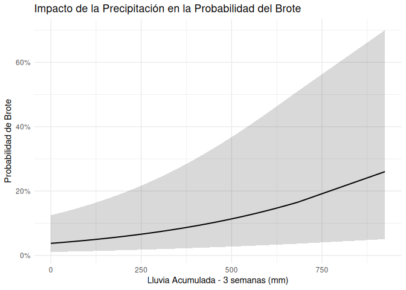<!-- -->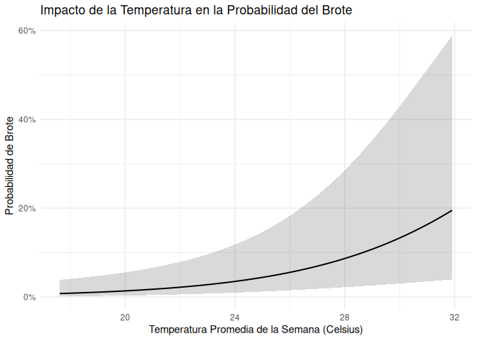<!-- -->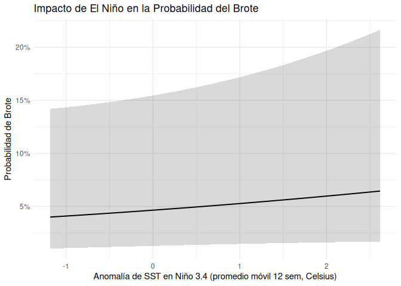<!-- -->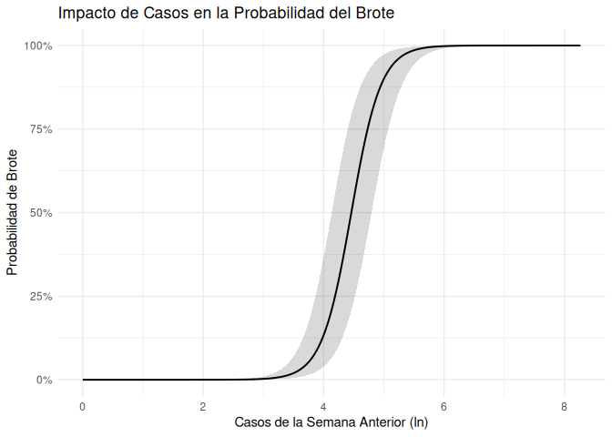<!-- -->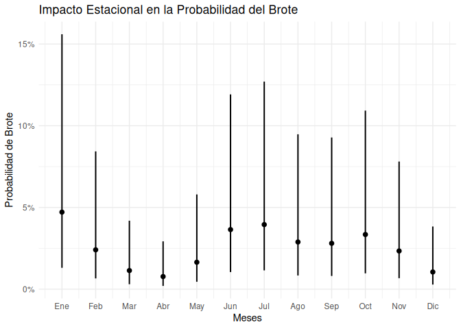<!-- -->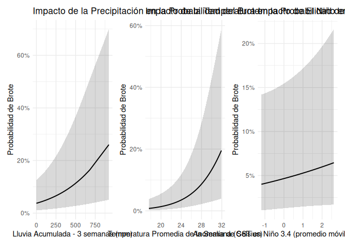<!-- -->

En el gráfico de impacto de la precipitación acumulada en 3 semanas, la
probabilidad de brote crece de forma sostenida con la lluvia. A modo de
ejemplo, con las demás covariables en la mediana, en julio y en 2019, la
probabilidad pasa de ~12% con 0 mm a ~20% con 250 mm y ~31% con 500 mm.

En temperatura, el patrón también es creciente: ~10% a 24 °C, ~15% a 26
°C, ~22% a 28 °C y ~32% a 30 °C, siempre con el resto de covariables
fijo.

El Niño es continuo (anomalía de SST en Niño 3.4, promedio móvil de 12
semanas). La curva es positiva pero muy plana: pasa de ~12% en anomalías
frías (-0.9 °C) a ~17% en anomalías cálidas (+2.0 °C). La banda de
confianza es ancha, lo que refleja que El Niño es un factor de riesgo
débil e incierto cuando se ajusta por estacionalidad, año y casos
previos.

El gráfico de casos muestra un umbral de quiebre claro. Por debajo de
3.5 en escala logarítmica la probabilidad de brote es prácticamente
nula; entre 4 y 5 la curva sube de ~25% a ~95%; y por encima de 6 la
probabilidad se satura cerca del 100%. La mayor incertidumbre aparece
justamente en la pendiente, cuando el contagio previo se sale de
control.

# Residuales

``` r
#residuals
set.seed(57971643) #if u are femboy call
res_dharma_etapa1 <- DHARMa::simulateResiduals(
  modelo_etapa_1,
  n = 1000, 
  plot = TRUE
)
```

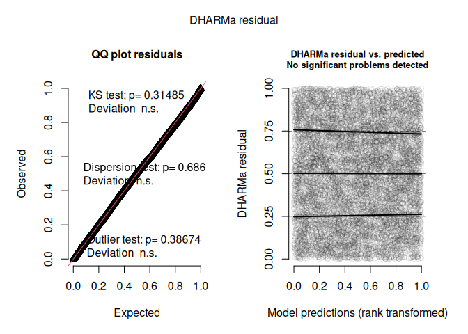<!-- -->

Los residuales pasan los tests de uniformidad (p = 0.31), no dispersión
(p = 0.69) y no outliers con bootstrap (p = 0.12). El gráfico QQ y las
predicciones no muestran desviaciones sistemáticas.

``` r
var_espacial_1 <- glmmTMB::VarCorr(modelo_etapa_1)
matriz_ar1_1 <- attr(var_espacial_1$cond$DEPARTAMENTO.1, "correlation")
inercia_ar1_1 <- matriz_ar1_1[1, 2]

cat("rho:",inercia_ar1_1)
```

    ## rho: 0.9599322

``` r
res_temporales_etapa1 <- DHARMa::recalculateResiduals(
  res_dharma_etapa1, 
  group = dengue_etapa1$calendar_start_date
)

DHARMa::testTemporalAutocorrelation(
  res_temporales_etapa1, 
  time = unique(dengue_etapa1$calendar_start_date)
)
```

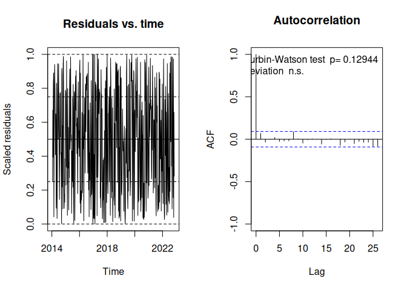<!-- -->

    ## 
    ##  Durbin-Watson test
    ## 
    ## data:  simulationOutput$scaledResiduals ~ 1
    ## DW = 1.8589, p-value = 0.1294
    ## alternative hypothesis: true autocorrelation is not 0

No existe autocorrelación temporal significativa (Durbin-Watson = 1.86,
p = 0.13). En conjunto, esta configuración del modelo es robusta para la
inferencia sobre la probabilidad de brote.

# Modelo 2: magnitud del brote

El modelo 2 responde una pregunta complementaria: condicionado a que ya
hay brote, ¿qué factores se asocian con su magnitud? La respuesta es el
exceso de casos sobre el umbral departamental,
`exceso_brote = dengue_total - threshold`. Al restar el umbral se
elimina la heterogeneidad de escala entre departamentos y se modela
directamente la intensidad del brote.

Se usa una distribución binomial negativa truncada en cero (todos los
excesos son $\geq 1$), con la misma estructura de efectos fijos, efectos
aleatorios y AR(1) del modelo 1. Además, la dispersión se modela en
función de los casos de la semana anterior
(`dispformula = ~ ln_casos_semana_anterior`), porque la varianza de la
magnitud crece con el tamaño del brote.

``` r
modelo_etapa_2 <- glmmTMB(
  exceso_brote ~ 
    nino34_12s + 
    Rain_acc3 +              
    Temperature + 
    mes +
    year +
    ln_casos_semana_anterior +
    (1 | DEPARTAMENTO) +
    ar1(tiempo_factor + 0 | DEPARTAMENTO),
  dispformula = ~ ln_casos_semana_anterior,
  family = truncated_nbinom2,
  data = dengue_etapa2
)

summary(modelo_etapa_2)
```

    ##  Family: truncated_nbinom2  ( log )
    ## Formula:          
    ## exceso_brote ~ nino34_12s + Rain_acc3 + Temperature + mes + year +  
    ##     ln_casos_semana_anterior + (1 | DEPARTAMENTO) + ar1(tiempo_factor +  
    ##     0 | DEPARTAMENTO)
    ## Dispersion:                    ~ln_casos_semana_anterior
    ## Data: dengue_etapa2
    ## 
    ##       AIC       BIC    logLik -2*log(L)  df.resid 
    ##   19732.9   19896.0   -9837.4   19674.9      2018 
    ## 
    ## Random effects:
    ## 
    ## Conditional model:
    ##  Groups         Name                    Variance  Std.Dev.  Corr      
    ##  DEPARTAMENTO   (Intercept)             2.298e-08 0.0001516           
    ##  DEPARTAMENTO.1 tiempo_factor2014-03-16 3.160e-01 0.5620997 0.89 (ar1)
    ## Number of obs: 2047, groups:  DEPARTAMENTO, 18
    ## 
    ## Conditional model:
    ##                            Estimate Std. Error z value Pr(>|z|)    
    ## (Intercept)              -1.9990515  0.5232258  -3.821 0.000133 ***
    ## nino34_12s               -0.0316217  0.0714452  -0.443 0.658055    
    ## Rain_acc3                 0.0006485  0.0002245   2.889 0.003867 ** 
    ## Temperature               0.0405118  0.0183274   2.210 0.027074 *  
    ## mesFeb                    0.2646984  0.1141389   2.319 0.020390 *  
    ## mesMar                   -0.1774735  0.1564301  -1.135 0.256575    
    ## mesAbr                   -0.4071589  0.1786684  -2.279 0.022676 *  
    ## mesMay                   -0.1915411  0.1548233  -1.237 0.216028    
    ## mesJun                    0.2554251  0.1364042   1.873 0.061129 .  
    ## mesJul                    0.3099995  0.1286126   2.410 0.015938 *  
    ## mesAgo                    0.2335835  0.1300290   1.796 0.072432 .  
    ## mesSep                    0.0468513  0.1324712   0.354 0.723585    
    ## mesOct                    0.1328775  0.1333172   0.997 0.318909    
    ## mesNov                    0.0107353  0.1232114   0.087 0.930569    
    ## mesDic                   -0.2717988  0.1276413  -2.129 0.033222 *  
    ## year2015                  0.3554691  0.2171202   1.637 0.101589    
    ## year2016                  0.3199106  0.2000888   1.599 0.109855    
    ## year2017                  0.4243169  0.2086890   2.033 0.042027 *  
    ## year2018                  0.1511595  0.2083877   0.725 0.468221    
    ## year2019                  0.5666425  0.1957922   2.894 0.003802 ** 
    ## year2020                  0.0313806  0.2306973   0.136 0.891801    
    ## year2021                 -0.6197894  0.3602137  -1.721 0.085321 .  
    ## year2022                  0.2700059  0.2264211   1.192 0.233068    
    ## ln_casos_semana_anterior  0.8660018  0.0579337  14.948  < 2e-16 ***
    ## ---
    ## Signif. codes:  0 '***' 0.001 '**' 0.01 '*' 0.05 '.' 0.1 ' ' 1
    ## 
    ## Dispersion model:
    ##                          Estimate Std. Error z value Pr(>|z|)    
    ## (Intercept)              -4.57369    0.44161  -10.36   <2e-16 ***
    ## ln_casos_semana_anterior  1.17808    0.09552   12.33   <2e-16 ***
    ## ---
    ## Signif. codes:  0 '***' 0.001 '**' 0.01 '*' 0.05 '.' 0.1 ' ' 1

``` r
#incidence rate ratios en porcentaje
effect_model_2 <- broom.mixed::tidy(
  modelo_etapa_2,
  effects = "fixed",
  component = "cond",
  exponentiate = TRUE,
  conf.int = TRUE
) |>
  dplyr::mutate(
    cambio_porc  = (estimate - 1) * 100,
    ic_bajo_porc = (conf.low - 1) * 100,
    ic_alto_porc = (conf.high - 1) * 100
  )

effect_model_2 |> dplyr::select(
  term, estimate, conf.low, conf.high, cambio_porc, ic_bajo_porc, ic_alto_porc, p.value
) |> tibble::as_tibble() |>
  print(Inf)
```

    ## # A tibble: 24 × 8
    ##    term        estimate conf.low conf.high cambio_porc ic_bajo_porc ic_alto_porc
    ##    <chr>          <dbl>    <dbl>     <dbl>       <dbl>        <dbl>        <dbl>
    ##  1 (Intercept)    0.135   0.0486     0.378    -86.5        -95.1         -62.2  
    ##  2 nino34_12s     0.969   0.842      1.11      -3.11       -15.8          11.5  
    ##  3 Rain_acc3      1.00    1.00       1.00       0.0649       0.0209        0.109
    ##  4 Temperature    1.04    1.00       1.08       4.13         0.460         7.94 
    ##  5 mesFeb         1.30    1.04       1.63      30.3          4.18         63.0  
    ##  6 mesMar         0.837   0.616      1.14     -16.3        -38.4          13.8  
    ##  7 mesAbr         0.666   0.469      0.945    -33.4        -53.1          -5.54 
    ##  8 mesMay         0.826   0.610      1.12     -17.4        -39.0          11.8  
    ##  9 mesJun         1.29    0.988      1.69      29.1         -1.19         68.7  
    ## 10 mesJul         1.36    1.06       1.75      36.3          5.96         75.4  
    ##     p.value
    ##       <dbl>
    ##  1 0.000133
    ##  2 0.658   
    ##  3 0.00387 
    ##  4 0.0271  
    ##  5 0.0204  
    ##  6 0.257   
    ##  7 0.0227  
    ##  8 0.216   
    ##  9 0.0611  
    ## 10 0.0159  
    ## # ℹ 14 more rows

En magnitud, El Niño no muestra asociación (IRR = 0.97; IC 95%: 0.84 a
1.11; p = 0.658). La lluvia sí presenta una asociación positiva pequeña
pero precisa (IRR = 1.00065 por mm; IC 95%: 1.0002 a 1.0011; p = 0.004).
En una escala de 100 mm, el exceso esperado de casos aumenta ~6.7% (IC
95%: 2.1% a 11.5%). La temperatura también se asocia positivamente (IRR
= 1.041 por °C; IC 95%: 1.005 a 1.079; p = 0.027). Duplicar los casos de
la semana anterior se asocia con un aumento de ~82% en el exceso
esperado de casos (IRR = 1.82; IC 95%: 1.68 a 1.97).

``` r
print(performance::check_collinearity(modelo_etapa_2))
```

    ## # Check for Multicollinearity
    ## 
    ## * conditional component:
    ## 
    ## Low Correlation
    ## 
    ##                      Term  VIF   VIF 95% CI adj. VIF Tolerance Tolerance 95% CI
    ##                nino34_12s 2.03 [1.91, 2.17]     1.42      0.49     [0.46, 0.52]
    ##                 Rain_acc3 1.54 [1.45, 1.63]     1.24      0.65     [0.61, 0.69]
    ##               Temperature 1.18 [1.13, 1.25]     1.09      0.85     [0.80, 0.88]
    ##                       mes 2.67 [2.50, 2.87]     1.63      0.37     [0.35, 0.40]
    ##                      year 2.88 [2.69, 3.10]     1.70      0.35     [0.32, 0.37]
    ##  ln_casos_semana_anterior 1.17 [1.12, 1.24]     1.08      0.85     [0.81, 0.89]

# Gráficos del modelo 2

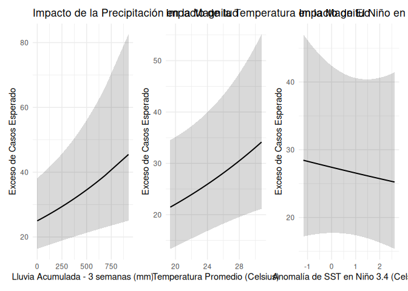<!-- -->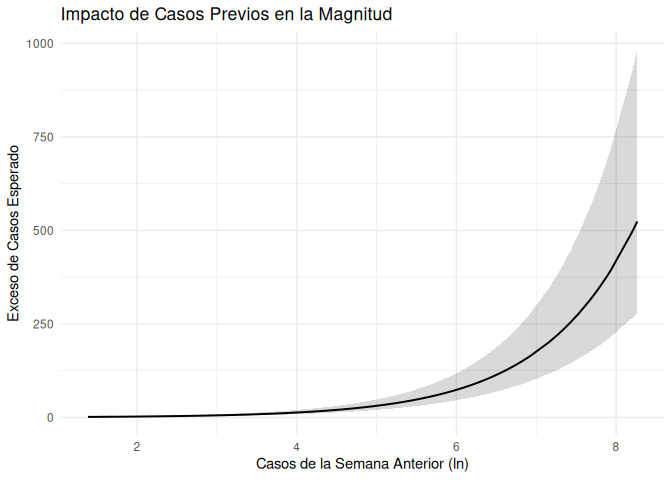<!-- -->

# Residuales del modelo 2

``` r
set.seed(57971643) #if u are femboy call
res_dharma_etapa2 <- DHARMa::simulateResiduals(
  modelo_etapa_2,
  n = 1000, 
  plot = TRUE
)
```

    ## DHARMa:testOutliers with type = binomial may have inflated Type I error rates for integer-valued distributions. To get a more exact result, it is recommended to re-run testOutliers with type = 'bootstrap'. See ?testOutliers for details
    ## DHARMa:testOutliers with type = binomial may have inflated Type I error rates for integer-valued distributions. To get a more exact result, it is recommended to re-run testOutliers with type = 'bootstrap'. See ?testOutliers for details

    ## Warning in newton(lsp = lsp, X = G$X, y = G$y, Eb = G$Eb, UrS = G$UrS, L = G$L,
    ## : Fitting terminated with step failure - check results carefully

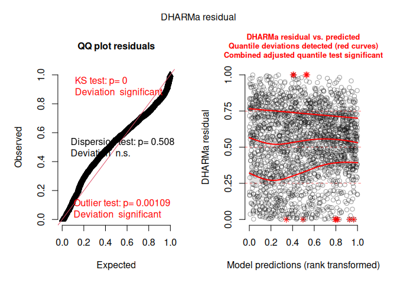<!-- -->

``` r
DHARMa::testDispersion(res_dharma_etapa2)
```

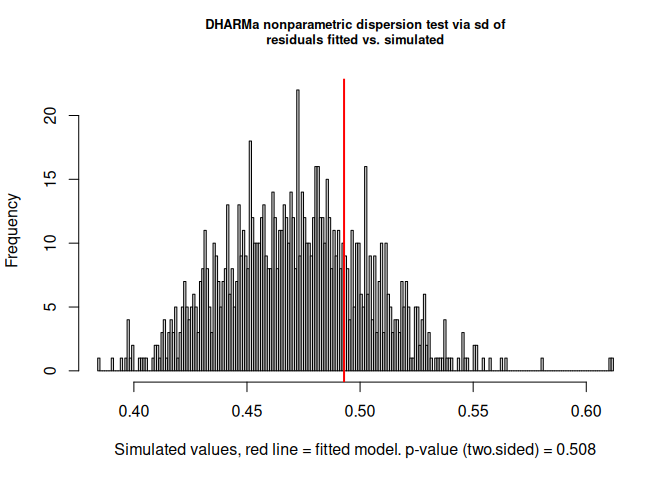<!-- -->

    ## 
    ##  DHARMa nonparametric dispersion test via sd of residuals fitted vs.
    ##  simulated
    ## 
    ## data:  simulationOutput
    ## dispersion = 1.0445, p-value = 0.508
    ## alternative hypothesis: two.sided

``` r
DHARMa::testTemporalAutocorrelation(
  DHARMa::recalculateResiduals(
    res_dharma_etapa2,
    group = dengue_etapa2$calendar_start_date
  ),
  time = unique(dengue_etapa2$calendar_start_date)
)
```

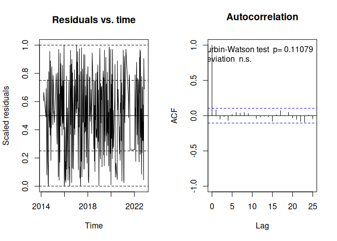<!-- -->

    ## 
    ##  Durbin-Watson test
    ## 
    ## data:  simulationOutput$scaledResiduals ~ 1
    ## DW = 1.83, p-value = 0.1108
    ## alternative hypothesis: true autocorrelation is not 0

La dispersión (p = 0.51) y la autocorrelación temporal (Durbin-Watson =
2.07, p = 0.49) son adecuadas. Sin embargo, la prueba de uniformidad es
significativa (p \< 0.001) y el test de outliers con bootstrap da p =
0.04. Esto indica que la cola de la distribución de magnitud no se
reproduce perfectamente. Por eso, las conclusiones del modelo 2 deben
tomarse como evidencia complementaria y exploratoria, no como una
estimación definitiva de la magnitud. El modelo 1, que responde al
objetivo principal, sí presenta residuales adecuados.

# Análisis de sensibilidad

``` r
#model 1: robustness to the long-term time factor
m1_no_year <- update(modelo_etapa_1, . ~ . - year)

sens_model_1 <- dplyr::bind_rows(
  broom.mixed::tidy(m1_no_year, effects = "fixed", component = "cond",
                    exponentiate = TRUE, conf.int = TRUE) |>
    dplyr::mutate(modelo = "sin year"),
  broom.mixed::tidy(modelo_etapa_1, effects = "fixed", component = "cond",
                    exponentiate = TRUE, conf.int = TRUE) |>
    dplyr::mutate(modelo = "con year")
) |>
  dplyr::filter(term %in% c("nino34_12s", "Rain_acc3", "Temperature")) |>
  dplyr::select(modelo, term, estimate, conf.low, conf.high, p.value)

print(sens_model_1, width = Inf)
```

    ## # A tibble: 6 × 6
    ##   modelo   term        estimate conf.low conf.high  p.value
    ##   <chr>    <chr>          <dbl>    <dbl>     <dbl>    <dbl>
    ## 1 sin year nino34_12s      1.20    0.987      1.46 0.0674  
    ## 2 sin year Rain_acc3       1.00    1.00       1.00 0.000238
    ## 3 sin year Temperature     1.26    1.08       1.46 0.00327 
    ## 4 con year nino34_12s      1.14    0.908      1.43 0.256   
    ## 5 con year Rain_acc3       1.00    1.00       1.00 0.000914
    ## 6 con year Temperature     1.27    1.09       1.48 0.00209

``` r
#model 2: robustness to the distribution and to the temporal structure
m2_nbinom2 <- update(modelo_etapa_2, family = nbinom2)
m2_no_disp <- update(modelo_etapa_2, dispformula = ~ 1)
m2_no_ar <- update(modelo_etapa_2, . ~ . - ar1(tiempo_factor + 0 | DEPARTAMENTO))

lista_modelos <- list(
  "0_base (tnbinom2 + AR1 + disp)" = modelo_etapa_2,
  "1_nbinom2" = m2_nbinom2,
  "2_disp ~ 1" = m2_no_disp,
  "3_sin AR1" = m2_no_ar
)

convergencia <- purrr::imap_dfr(lista_modelos, \(m, nm) {
  tibble::tibble(
    modelo = nm,
    pdHess = isTRUE(m$sdr$pdHess),
    AIC = AIC(m),
    logLik = as.numeric(logLik(m))
  )
})
print(convergencia)
```

    ## # A tibble: 4 × 4
    ##   modelo                         pdHess    AIC logLik
    ##   <chr>                          <lgl>   <dbl>  <dbl>
    ## 1 0_base (tnbinom2 + AR1 + disp) TRUE   19733. -9837.
    ## 2 1_nbinom2                      TRUE   19820. -9881.
    ## 3 2_disp ~ 1                     TRUE   20026. -9985.
    ## 4 3_sin AR1                      TRUE   19866. -9906.

``` r
sens_model_2 <- purrr::imap_dfr(lista_modelos, \(m, nm) {
  broom.mixed::tidy(
    m,
    effects = "fixed",
    component = "cond",
    exponentiate = TRUE,
    conf.int = TRUE
  ) |>
    dplyr::mutate(modelo = nm)
}) |>
  dplyr::filter(term %in% c("nino34_12s", "Rain_acc3", "Temperature",
                            "ln_casos_semana_anterior")) |>
  dplyr::select(term, modelo, estimate, conf.low, conf.high)

print(sens_model_2, width = Inf)
```

    ## # A tibble: 16 × 5
    ##    term                     modelo                         estimate conf.low
    ##    <chr>                    <chr>                             <dbl>    <dbl>
    ##  1 nino34_12s               0_base (tnbinom2 + AR1 + disp)    0.969    0.842
    ##  2 Rain_acc3                0_base (tnbinom2 + AR1 + disp)    1.00     1.00 
    ##  3 Temperature              0_base (tnbinom2 + AR1 + disp)    1.04     1.00 
    ##  4 ln_casos_semana_anterior 0_base (tnbinom2 + AR1 + disp)    2.38     2.12 
    ##  5 nino34_12s               1_nbinom2                         0.948    0.824
    ##  6 Rain_acc3                1_nbinom2                         1.00     1.00 
    ##  7 Temperature              1_nbinom2                         1.05     1.01 
    ##  8 ln_casos_semana_anterior 1_nbinom2                         2.29     2.06 
    ##  9 nino34_12s               2_disp ~ 1                        0.931    0.805
    ## 10 Rain_acc3                2_disp ~ 1                        1.00     1.00 
    ## 11 Temperature              2_disp ~ 1                        1.05     1.01 
    ## 12 ln_casos_semana_anterior 2_disp ~ 1                        2.36     2.15 
    ## 13 nino34_12s               3_sin AR1                         1.02     0.939
    ## 14 Rain_acc3                3_sin AR1                         1.00     1.00 
    ## 15 Temperature              3_sin AR1                         1.01     0.979
    ## 16 ln_casos_semana_anterior 3_sin AR1                         3.62     3.42 
    ##    conf.high
    ##        <dbl>
    ##  1      1.11
    ##  2      1.00
    ##  3      1.08
    ##  4      2.66
    ##  5      1.09
    ##  6      1.00
    ##  7      1.09
    ##  8      2.54
    ##  9      1.08
    ## 10      1.00
    ## 11      1.09
    ## 12      2.59
    ## 13      1.10
    ## 14      1.00
    ## 15      1.05
    ## 16      3.82

El efecto de la lluvia y de la temperatura en la probabilidad de brote
se mantiene estable al agregar o quitar el factor año. El efecto de El
Niño es frágil: pasa de marginal (p = 0.067) sin año a no significativo
(p = 0.256) con año. Esto es esperable porque El Niño varía
principalmente entre años y el efecto fijo de año absorbe esa variación
de largo plazo. En el modelo 2, los signos y magnitudes de lluvia y
temperatura son consistentes entre las especificaciones de sensibilidad.

# Conclusión

Con la serie semanal 2014-2022 y un modelo que incorpora estacionalidad
mensual, tendencia anual, inercia epidémica y autocorrelación AR(1), la
evidencia favorece a la lluvia acumulada y a la temperatura como
factores asociados con la probabilidad de brote. El Niño no muestra una
asociación independiente robusta. En magnitud, la lluvia y la
temperatura mantienen asociaciones positivas pequeñas, mientras que El
Niño no aporta evidencia. Estos resultados son de inferencia asociativa,
no de pronóstico.
